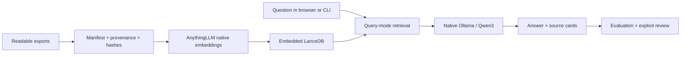

# LoreDock

**Private knowledge. Answers with sources.**

A reproducible, self-hosted RAG starter kit built around AnythingLLM and native Ollama. Import readable documents, ask questions in an existing browser interface, inspect the supporting passages, and evaluate answers against a versioned question set.

The included **Northstar Demo** organization is fictional. No employer documents or production data are included. This is a laptop demonstration; production capacity and employee access controls are not established by it.

## What this repository contributes

- Repeatable, localhost-only Docker configuration with an immutable AnythingLLM image.
- A dependency-free Python client and CLI for native model serving, verified ingestion, content-hash updates, and evaluations.
- Seven fictional source documents and 30 evaluation questions covering exceptions, missing answers, proposals, and conflicting dates.
- JSON/Markdown evidence, separate human/agent reviews, update checks, and backup/restore tools.
- Architecture decisions and operating instructions, with upstream components credited.

AnythingLLM supplies the chat UI, extraction/embedding integration, retrieval, and workspace application. Ollama supplies model serving. LoreDock configures and evaluates these components; it does not implement a new chat UI or language model.

## Quick start on Apple silicon

Requires Git, Python **3.10+**, Docker Desktop with Compose, and native Ollama. The reference machine is an M3 Pro with 18 GB unified memory. Allow space for the container image, a roughly 5.2 GB model download, and runtime data; actual runtime memory exceeds model-file size.

```bash
git clone https://github.com/mehboobali98/loredock.git
cd loredock

# Install Ollama if absent, and start Docker Desktop.
brew install ollama
open /Applications/Docker.app

# No Python package installation or paid model API key is required.
python3 -m loredock demo
```

The first run downloads the model and, during ingestion, the embedding weights. Later runs reuse local files. Open **http://127.0.0.1:3001** and select **LoreDock Demo Policies** or **LoreDock Demo Company Context**. If onboarding is shown, select the configured local providers and complete it; do not enable optional memory or tools.

Example questions:

- “An emergency means I cannot give five working days of leave notice. What should I do?”
- “Does an expense of exactly USD 25 require a receipt?”
- In Company Context: “What is the confirmed onboarding checklist rollout date?”
- “Which company provides our health insurance?”

Expand AnythingLLM's source cards to inspect the supporting text. Answers also request stable document labels such as `[LD-LEAVE]`; these labels do not independently prove that every claim is supported.

## Reproduce the evaluation

```bash
python3 -m loredock eval
# The command prints the runtime report path outside the repository.
python3 -m loredock report /absolute/path/to/loredock-local/runs/RUN.json
```

The suite has 20 answerable questions, five unsupported questions, and five ambiguous/proposal/conflict questions. Each question gets a fresh API session in Query mode. A warm-up request is excluded from measured latency. Reports include complete answers, returned passages, source IDs, timings, configuration, and model digest.

**Unreviewed results stay pending.** An expected document being retrieved is only a diagnostic. A human must judge correctness, conditions, and support against the displayed rubric. Agent assessments are recorded separately and cannot satisfy the human quality gate. See [evaluation methodology](evaluation/README.md) and [validation status](docs/validation.md).

```bash
python3 -m loredock review /path/to/RUN.json /path/to/annotations.json --reviewer human
python3 -m loredock export-public /path/to/RUN.json
```

Public export accepts only a report whose bundled fictional corpus and question-suite hashes match, and checks that its workspaces contain only registered documents. Inspect the exported files before committing them. Private corpus reports have no public-export path.

## Where data lives

By default, the sibling directory `../loredock-local/` contains application storage, the local API key, models, logs, ingestion state, evaluations, and backups. It is created with restrictive permissions. Set `LOREDOCK_HOME` to another dedicated directory **outside the checkout** before running commands to relocate it.

```bash
export LOREDOCK_HOME="$HOME/loredock-local"
python3 -m loredock init
```

The CLI creates an AnythingLLM application key for its fresh, local, single-operator instance and stores it in `config.json` outside Git. This key is not a cloud-model subscription key. Existing password-protected instances require a key generated through the UI and corresponding UI preference setup; the automated demo targets a fresh instance.

## Commands

| Command | Purpose |
|---|---|
| `demo` | Prepare runtime, download model, start app, configure, and ingest the fictional corpus |
| `model start / pull / stop` | Manage LoreDock's native Ollama server and model |
| `up / down / logs` | Start/stop AnythingLLM and inspect service logs |
| `configure` | Apply local provider and chunking preferences |
| `ingest --manifest PATH` | Import, skip unchanged content, replace changed documents, withdraw removed entries |
| `ask policies "QUESTION"` | Ask the fictional Policies workspace |
| `eval --limit 3` | Small live-model smoke evaluation |
| `eval` | Full 30-question evaluation |
| `verify-update` | Use a temporary workspace to check a 20-to-22-day synthetic policy replacement |
| `backup` | Stop writes, archive state, and restart the app |
| `restore ARCHIVE --replace` | Restore while retaining previous state in a recovery directory |
| `doctor` | Show nonsecret runtime settings and versions |

## Architecture and tradeoffs



Start with [architecture](docs/architecture.md), [decision records](docs/decisions/README.md), [operations](docs/operations.md), and the [walkthrough](docs/walkthrough.md).

## Development

```bash
python3 -m venv .venv
source .venv/bin/activate
python -m pip install --editable '.[dev]'
ruff check loredock tests
ruff format --check loredock tests
mypy
python3 -m unittest discover -s tests -v
python3 -m loredock --help
```

CI tests the tooling and Compose configuration. It does not simulate a passing model evaluation or require paid API access.

## Limits and next steps

- English text/Markdown exports first. PDF/OCR, Google authentication, and live connectors are outside the initial importer.
- Query mode treats questions independently; stored chat history remains visible, but follow-up references may need explicit context. Additional memory is deferred.
- Native-model performance depends on hardware and context. Results are a small synthetic benchmark, not a broad model comparison.
- Localhost access is for one trusted operator. Shared deployment requires authentication, permission enforcement, source freshness, and capacity testing.
- More employees do not automatically require a new vector database. Measure concurrency, retrieval latency, and update load before changing it.
- See [private document validation](docs/private-documents.md) before importing real material. Keep it outside Git and in separate workspaces.

## Credits and license

LoreDock's code and fictional examples use the [MIT license](LICENSE). [AnythingLLM](https://github.com/Mintplex-Labs/anything-llm), [Ollama](https://github.com/ollama/ollama), [Qwen3](https://ollama.com/library/qwen3:8b), [MiniLM](https://huggingface.co/sentence-transformers/all-MiniLM-L6-v2), and [LanceDB](https://github.com/lancedb/lancedb) retain their own licenses. Their source, model files, and container images are referenced rather than redistributed here.
