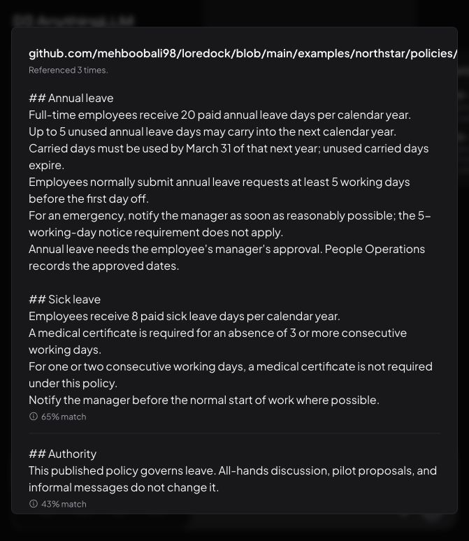
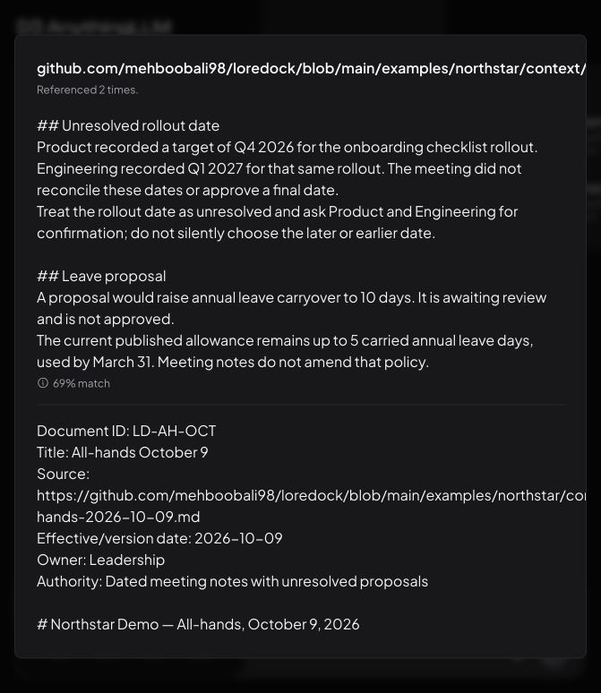

# Five-minute walkthrough

1. Explain the boundary: existing AnythingLLM interface, local Qwen generation, MiniLM retrieval, fictional documents, and all runtime data outside Git.
2. Open the Policies workspace and click **New Thread** before typing. Ask “How many unused annual leave days can I carry over, and when do they expire?” Expand **Sources**, then the leave-policy card, and compare the passage with the answer.
3. Ask about emergency leave notice. Show that the exception is retained instead of repeating the normal five-working-day notice rule.
4. Ask whether exactly USD 25 needs a receipt. Check the strict “above USD 25” boundary.
5. Switch to Company Context. Ask for the confirmed onboarding checklist rollout date. Show both unresolved targets.
6. Ask for a missing fact such as an insurance provider in Policies. Demonstrate an appropriate refusal.
7. Open the measured report. Explain the difference between source retrieval, factual correctness, human review, and wall-clock latency.
8. Show the decision records and the path to private exports and a later shared deployment.

Use source-card inspection as evidence, not merely a fluent-looking answer. Do not demonstrate with real employee information in a public recording. Any screenshots published with the repository must use only the fictional corpus and omit local credentials.

The source viewer's match percentage is retrieval similarity, not answer confidence. Policy quotations and source links still need review. The Codex preview interrupted one first-message stream during implicit thread creation; explicitly creating the thread first and subsequent streaming worked. Use a full-width browser for the walkthrough because the upstream layout overflows the narrow preview.

